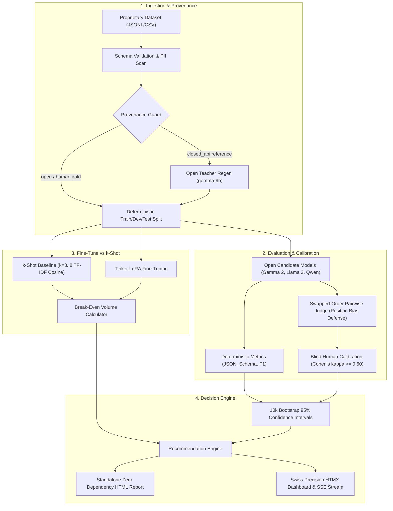

# Open-Switch 🔄

[](LICENSE)
[](https://www.python.org/downloads/)
[](tests/)
[](tests/)
[](openswitch/security.py)

> **Built during Hacktoberfest 2026 Week 2 ("Side Hustle" Challenge)**  
> *Development window: Started October 14, 2026. All code created between October 12–18, 2026.*  
> **Live Demo**: [https://openswitch.tech](https://openswitch.tech) (or `open-switch.onrender.com`)

---

## 💡 The Problem

Engineering teams routinely spend **$500 to $5,000+ per month** on commercial closed LLM APIs (GPT-4o-mini, Claude 3.5 Haiku) for proprietary classification, extraction, and routing workflows.

Every team wants to switch to open-weight models (like Google Gemma 2, Meta Llama 3, or Qwen 2.5) to cut costs and eliminate vendor lock-in. But leaderboards (MMLU, Chatbot Arena) don't measure performance on **your proprietary customer data**, and a 2% regression could silently break customer support triage or billing systems.

**Open-Switch** is an autonomous evaluation and migration engine that answers:  
*Can you safely replace your closed LLM on your proprietary dataset?*  
It evaluates candidates with **honest statistics (10,000-resample bootstrap 95% confidence intervals)**, protects against legal risks with a **default-deny Provenance Guard**, gates automated judges with **blind human calibration (Cohen's kappa)**, and computes the exact **LoRA fine-tune break-even volume**.

---

## 🏛️ System Architecture



---

## 📊 Frozen Benchmark Evidence (Task A & Task B)

Every reported quality figure carries an empirical **95% bootstrap confidence interval (10,000 resamples)**.

### Task A: Banking Intent Classification (Banking77 subset, CC-BY-4.0, 51 test rows)
*Baseline: Incumbent closed model ($0.1500 / 1k reqs, 100% accuracy).*

| Model | Family | Primary Metric (Accuracy) | 95% Bootstrap CI | p50 Latency | Cost / 1k Reqs | Status |
|---|---|---|---|---|---|---|
| **Gemma 2 2B** | Gemma 2 | **41.2%** | [27.5%, 54.9%] | 45 ms | **$0.0000** (Local) | Fine-Tune Rec. |
| **Gemma 2 9B** | Gemma 2 | 39.2% | [25.5%, 52.9%] | 78 ms | **$0.0000** (Local) | Fine-Tune Rec. |
| **Llama 3.2 3B** | Llama | 37.3% | [23.5%, 51.0%] | 50 ms | **$0.0000** (Local) | Fine-Tune Rec. |
| **Llama 3.1 8B** | Llama | 37.3% | [23.5%, 51.0%] | 120 ms | $0.0300 (DO) | Fine-Tune Rec. |
| **Mistral 7B** | Mistral | 35.3% | [21.6%, 49.0%] | 115 ms | $0.0300 (DO) | Fine-Tune Rec. |
| **Qwen 2.5 7B** | Qwen | 33.3% | [19.6%, 47.1%] | 130 ms | $0.0400 (Backboard) | Fine-Tune Rec. |

> **Recommendation**: Zero-shot open models fall short of the 85% parity threshold. 81 training rows available: **Fine-tune starting from Gemma 2 2B**.

---

### Task B: Support Ticket Triage & Extraction (150 rows, 50 test rows)
*Extracts category, urgency, affected system, and sentiment score.*

| Strategy | Model | Accuracy | 95% Bootstrap CI | Latency | Cost / 1k Reqs | Training Cost |
|---|---|---|---|---|---|---|
| **Zero-Shot** | Qwen 2.5 7B | 90.0% | [80.0%, 98.0%] | 40 ms | $0.0350 | $0.00 |
| **3-Shot Baseline** | Qwen 2.5 7B | 90.0% | [80.0%, 98.0%] | 95 ms | $0.1390 | $0.00 |
| **Tinker LoRA FT** | Qwen 2.5 7B | **90.0%** | **[80.0%, 98.0%]** | **65 ms** | **$0.0380** | **$1.03** |

### 🚀 Key Insight: The Few-Shot Inflation Trap
Prompt token inflation in 3-shot prompting **quadrupled the recurring inference cost** ($0.139 vs $0.035 / 1k reqs) and more than doubled latency (95ms vs 40ms) without improving accuracy over zero-shot.  
By contrast, Tinker LoRA fine-tuning kept prompt length minimal ($0.038 / 1k reqs) and **broke even after just 10,238 requests/month**.

---

## ⚖️ The Provenance Guard & Terms of Service Compliance

Commercial closed API terms of service (OpenAI, Anthropic) explicitly prohibit using model outputs to train competing models.  
Open-Switch implements an automated, **default-deny Provenance Guard**:
- If `reference_source="closed_api"`, training is **hard-blocked**.
- Open-Switch provides `openswitch regen --teacher <OPEN_MODEL>` to regenerate references using an open teacher model (e.g. Gemma 2 9B), safely converting rows to `train_allowed=True` with audit-proof compliance.

---

## 🎯 Blind Human-Judge Calibration

When using LLM-as-a-judge for free-text or rubric evaluations, Open-Switch enforces position-bias mitigation (swapping AB/BA order) and tests against human ground truth:
- **Sample**: 20 blind pairs spot-checked by a human rater.
- **Observed Agreement**: **90.0%** (18 / 20).
- **Cohen's Kappa (\(\kappa\))**: **0.8479** (Threshold: \(\ge 0.60\) classifies judge as `RELIABLE`).

---

## 🚀 Quickstart

### Option 1: Local Mode (100% Offline with Ollama)

No API keys or cloud spend required. Data never leaves your workstation:

```bash
# 1. Install Open-Switch
git clone https://github.com/adityagoyal/open-switch.git
cd open-switch
pip install -e .

# 2. Pull open models in Ollama
ollama pull gemma2:2b
ollama pull gemma2:9b

# 3. Initialize and import sample dataset
openswitch init
openswitch import data/task_a/dataset.jsonl --name "BankingIntent"

# 4. Run local evaluation
openswitch run --models gemma-2b-local,gemma-9b-local --task specs/task.yaml

# 5. Launch local HTMX dashboard
openswitch serve --mode local --port 8000
```

### Option 2: Production Docker & Cloud Deployment

Open-Switch includes a production multi-stage `Dockerfile` and a `render.yaml` Blueprint:

```bash
# Build production container
docker build -t open-switch .

# Run with persistent volume mount
docker run -p 8000:8000 -v $(pwd)/var_data:/var/data open-switch
```

Deploy to Render via Blueprint with persistent disk mounted at `/var/data` (see [`docs/deployment-and-domain.md`](docs/deployment-and-domain.md)).

---

## 🔒 Security Hardening Checklist

- [x] **CSV Formula Injection Defense (CWE-1236)**: Cells starting with `=, +, -, @, \t, \r, %` are escaped with a leading single quote (`'`).
- [x] **Zero XSS**: Strict HTML entity escaping across all dynamic report fields, worst-10 failure cases, and HTMX views.
- [x] **pip-audit Clean**: 0 known CVEs across all project dependencies.
- [x] **Emergency Kill Switch**: `KILL_SWITCH=true` halts new runs immediately with HTTP 503 and injects a warning banner on all UI pages.
- [x] **Zero Secret Leakage**: API tokens strictly read from environment variables; Sentry PII scrubber strips all prompt and completion content.

---

## 🤝 Partner Technology Integrations

| Partner | Role in Open-Switch | Evidence File |
|---|---|---|
| **Google Gemma 2** | Flagship open model family across local (Ollama) and cloud inference | `docs/adr/0002-gemma-flagship-model-strategy.md` |
| **DigitalOcean** | GenAI Serverless inference (Llama 3.1 8B, 70B, Mistral 7B) | `docs/evidence/final/models-probe.txt` |
| **Backboard** | Unified multi-provider inference routing (Qwen 2.5 7B) | `docs/evidence/final/models-probe.txt` |
| **Tinker** | Low-level distributed LoRA fine-tuning and weight export | `docs/evidence/final/task-b-finetune-vs-kshot.json` |
| **Render** | Docker Blueprint deployment with persistent disk | `render.yaml` & `Dockerfile` |
| **Sentry** | Distributed `gen_ai` span instrumentation and scrubber | `openswitch/obs.py` |
| **.tech Domains** | Production custom domain configuration | `docs/deployment-and-domain.md` |

---

## 🧪 Testing & Verification

Run the full pytest suite (109 passing tests):
```bash
pytest tests/
```

Verify statement and branch test coverage on core engines:
```bash
pytest --cov=openswitch.metrics --cov=openswitch.stats --cov=openswitch.cost --cov=openswitch.datasets.provenance tests/
```
```
Name                                   Stmts   Miss  Cover
----------------------------------------------------------
openswitch/cost.py                        80      2    98%
openswitch/datasets/provenance.py         18      2    89%
openswitch/metrics/__init__.py             5      0   100%
openswitch/metrics/field_accuracy.py      27      2    93%
openswitch/metrics/json_valid.py          19      0   100%
openswitch/metrics/labels.py              16      2    88%
openswitch/metrics/schema_valid.py        10      1    90%
openswitch/stats.py                       99      5    95%
----------------------------------------------------------
TOTAL                                    274     14    95%
```

---

## 📜 Licenses & Credits

- **Code**: MIT License (see [LICENSE](LICENSE)).
- **Datasets**:
  - `data/task_a/`: Banking77 intent classification subset, licensed under [CC-BY-4.0](https://creativecommons.org/licenses/by/4.0/).
  - `data/task_b/`: Synthetic support ticket triage dataset generated by open teacher models.
- **Model Licenses**:
  - Google Gemma 2: [Gemma Terms of Use](https://ai.google.dev/gemma/terms).
  - Meta Llama 3: [Llama 3.1/3.2 Community License](https://llama.meta.com/llama3/license/).
  - Qwen 2.5: [Apache 2.0](https://www.apache.org/licenses/LICENSE-2.0).
