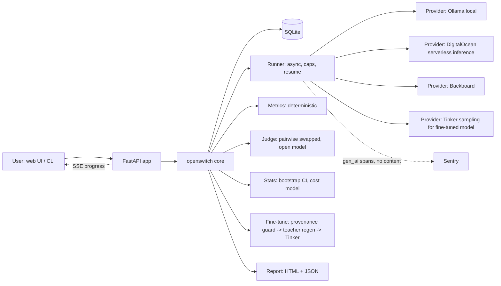

# 03 — Architecture

## 1. Principles
1. **One core library, three front ends** (CLI, web, report). All logic lives in `openswitch/`; front ends are thin.
2. **Few moving parts.** Python + SQLite + in-process async jobs. No Redis, no queue, no JS build step.
3. **Everything auditable.** Every number in a report traces to stored generations, scores and a config hash.
4. **Open by default.** Candidates, judge and teacher are open-weight models. The only closed model is the user's incumbent baseline, used as the reference.
5. **Same code hosted and local.** Provider endpoints are config.

## 2. Stack
| Layer | Choice | Why |
|---|---|---|
| Language | Python 3.12 | Fast to build, best SDK support |
| Web | FastAPI + Uvicorn, Jinja2, HTMX, Chart.js (vendored) | No build step, SSE for progress, standalone reports |
| HTTP | httpx (async, streaming) | TTFT measurement, retries |
| DB | SQLite via SQLAlchemy 2.0 (+ aiosqlite) | Zero ops, file on Render disk |
| Validation | Pydantic v2, jsonschema | Dataset/task/config contracts |
| CLI | Typer | Mirrors web flow |
| Tests | pytest, pytest-asyncio, respx | Mock all network |
| Quality | ruff, mypy (loose), pre-commit | Speed |
| Observability | sentry-sdk with gen_ai spans | Sentry category; verify attribute names in docs |
| Fine-tune | Tinker SDK (verify package name and API in docs) | Tinker category |
| Deploy | Docker, Render Blueprint (`render.yaml`), persistent disk | Render category |

## 3. System diagram


## 4. Repo layout (to be created by the agent)
```
open-switch/
  pyproject.toml  README.md  LICENSE(MIT)  Dockerfile  render.yaml  .env.example
  .github/workflows/ci.yml
  openswitch/
    config.py            # pydantic-settings, env, caps
    models.py            # SQLAlchemy tables
    db.py
    datasets/            # import.py, schema.py, splits.py, provenance.py, pii.py
    providers/           # base.py (Protocol), openai_compat.py, tinker_provider.py, fake.py, registry.py
    pricing.py           # loads pricing.yaml, verified_on, staleness
    runner.py            # concurrency, retries, resume, budget
    metrics/             # json_valid.py, fields.py, labels.py, rouge.py (optional)
    judge/               # prompt.py, judge.py, calibration.py
    stats.py             # bootstrap, parity, win rate, percentiles
    cost.py              # per-request cost, projections, break-even
    recommend.py
    finetune/            # teacher_regen.py, tinker_ft.py, kshot.py
    report/              # build.py, templates/report.html.j2, static/chart.min.js (vendored)
    obs.py               # Sentry init + gen_ai span helpers
    cli.py
    web/                 # app.py, routes.py, templates/, static/, ratelimit.py, cleanup.py
  data/                  # build scripts + README (licenses, seeds); no raw sensitive data
  specs/                 # copies of schema/config examples
  tests/                 # unit, integration, golden report
  docs/                  # evidence/, devlog.md, landscape.md, CHANGE-REQUESTS.md
```

## 5. Data model (SQLite)
- `experiments(id, name, dataset_id, config_json, config_hash, status, created_at, finished_at, git_commit)`
- `datasets(id, name, task_json, n_rows, sha256, seed, created_at)`
- `examples(id, dataset_id, idx, system_prompt, input, reference, reference_source, train_allowed, split, meta_json)`
- `model_defs(key, provider, model_id, family, license, kind, price_in_per_mtok, price_out_per_mtok, price_verified_on, price_source_url)` (loaded from YAML, snapshotted per experiment)
- `runs(id, experiment_id, model_key, status, est_cost, actual_cost, started_at, finished_at)`
- `generations(id, run_id, example_id, output, tokens_in, tokens_out, ttft_ms, latency_ms, cost_usd, error, usage_estimated)`
- `scores(id, generation_id, metric, value, details_json)`
- `judgments(id, generation_id, judge_model, verdict_ab, verdict_ba, final, rationale_json)`
- `human_labels(id, generation_id, label, labeler, created_at)`
- `finetunes(id, experiment_id, base_model, method, hyperparams_json, train_rows, status, provider_ref, cost_usd, time_s, result_model_key)`
- `reports(id, experiment_id, json_path, html_path, created_at)`
- `sessions(token_hash, created_at, last_seen)` for demo-mode ownership and rate limits

Idempotency key: `(run_id, example_id)` unique on `generations`. Resume = select examples without a successful generation.

## 6. Provider abstraction
```python
class ChatProvider(Protocol):
    async def chat(self, *, model: str, messages: list[dict], max_tokens: int,
                   temperature: float, response_format: dict | None,
                   stream: bool = True) -> ChatResult: ...
@dataclass
class ChatResult:
    text: str; tokens_in: int | None; tokens_out: int | None
    ttft_ms: float | None; latency_ms: float; usage_estimated: bool; raw_meta: dict
```
- `OpenAICompatProvider(base_url, api_key)` covers Ollama, DigitalOcean serverless inference, and Backboard **if** it is OpenAI-compatible (verify in T-007; otherwise write a small adapter).
- `FakeProvider` returns scripted outputs for tests.
- If the API omits usage, estimate tokens with a tokenizer and set `usage_estimated=true`; the report flags it.
- Defaults: temperature 0 for evaluation, fixed `max_tokens`, same system prompt and input for every model, no model-specific prompt tuning in the headline comparison (a separate, clearly labelled "tuned prompt" experiment is optional).
- Reasoning models: some open models emit hidden reasoning that can consume the token budget and return empty text. Detect empty output, retry once with a reasoning-off setting if the provider supports one, and log it. (A real bug other entrants hit.)

## 7. Experiment pipeline (state machine)
`created → validated → estimating → running(models in parallel) → scoring(deterministic) → judging → aggregating → reported` with `failed` and `cancelled` reachable from any state. Each stage is resumable. Estimated cost is computed in `estimating` and compared against caps before `running`.

## 8. Interfaces
**CLI**: `openswitch init | import PATH --task task.yaml | models probe | run --models a,b,c [--max-cost 2] | judge | calibrate | regen --teacher KEY | finetune --base KEY | report [--open] | serve`

**HTTP API** (JSON; the HTMX pages call these):
`POST /api/datasets` (multipart) · `GET /api/datasets/{id}` · `GET /api/models` · `POST /api/experiments` · `GET /api/experiments/{id}` · `GET /api/experiments/{id}/events` (SSE) · `POST /api/experiments/{id}/cancel` · `GET /api/experiments/{id}/report.json|.html` · `GET /api/calibration/next` · `POST /api/calibration/label` · `POST /api/finetunes` · `GET /health`

**Report**: single standalone HTML file; charts via vendored library inlined; no external requests; all dynamic text HTML-escaped; JSON export mirrors every number shown.

## 9. Deployment (Render)
- One Docker web service from `render.yaml`: `runtime: docker`, health check `/health`, persistent disk mounted at `/var/data` for SQLite and reports (a persistent disk needs a paid instance type; credits cover it).
- Environment variables (set `sync: false` for keys): `OPENSWITCH_MODE` (hosted|local), `DEMO_MODE`, `MAX_ROWS=200`, `MAX_UPLOAD_MB=2`, `MAX_CONCURRENT_EXPERIMENTS=2`, `MAX_EXPERIMENTS_PER_VISITOR_DAY=3`, `GLOBAL_DAILY_BUDGET_USD`, `EXPERIMENT_MAX_COST_USD`, `KILL_SWITCH`, `SENTRY_DSN`, provider keys.
- Custom domain: .tech domain claimed via promos, CNAME to the Render service.
- Auto-delete job: remove demo-mode datasets, generations and reports older than 24h.
- Fine-tuned model serving: decided by T-019/Q2. If Tinker supports weight export, optional stretch S-01 serves it with vLLM on a DigitalOcean GPU Droplet; otherwise evaluate via Tinker's sampling path and state the serving cost assumption honestly.

## 10. Security checklist
- Escape all dataset/model text in HTML (Jinja autoescape on; no `|safe` on user content). Model outputs can contain script tags.
- CSV export: prefix cells starting with `= + - @` to prevent formula injection.
- Upload limits (size, rows, content type), parse in a size-bounded way; reject non-UTF-8.
- No server-side URL fetching from user input (no SSRF surface).
- Judge prompt hardening: dataset content wrapped in delimiters and labelled as data; judge output must be strict JSON; anything else is retried once, then marked `invalid` and excluded with a count shown.
- Rate limiting per session cookie and per IP; global daily budget with kill switch; per-experiment cost cap.
- Secrets only via env; `.env` in `.gitignore`; Sentry `send_default_pii=False` and a `before_send` scrubber; never attach prompt or output text.
- Dependency audit (`pip-audit`) in CI.

## 11. Observability
- Sentry init in `obs.py`. Wrap each generation and judge call in a span with operation names and attributes following the Sentry agent-tracing docs (https://docs.sentry.io/product/agents/getting-started/): model, provider, input/output token counts, latency, estimated cost, prompt version. Content excluded.
- Capture Sentry issues for: judge inconsistency rate above 20%, provider error rate above 10%, empty-output rate above 5%, budget cap hit. Tag with experiment id and release (git commit).
- Keep one or two Sentry trace screenshots and one real caught issue for the post (see doc 06).

## 12. Testing strategy
- Unit: splits determinism, provenance defaults and guard, JSON/schema/field metrics, bootstrap CI against a known distribution, cost math, recommendation logic edge cases (n small, CI overlap), PII scan, CSV escaping.
- Integration: full pipeline with `FakeProvider` including resume after simulated crash; budget cap blocks a run; kill switch.
- Golden: a fixed fake experiment renders a report whose JSON matches a stored golden file.
- Security: XSS payload in a model output is escaped in the HTML report.
- CI: ruff, mypy, pytest, pip-audit on every push (GitHub Actions; ties into the GitHub Copilot category if Copilot review/agent is used).
